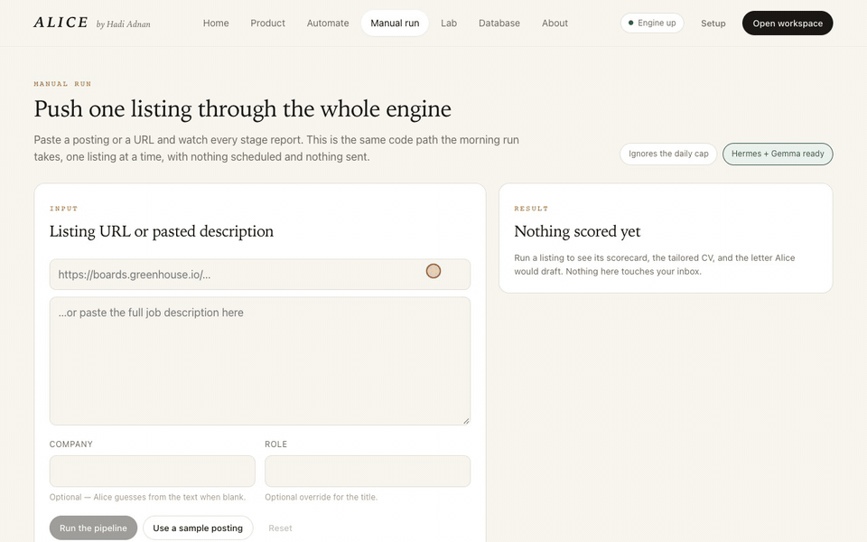

<p align="center">
  
</p>

<p align="center">
  
  
  
  
  
  
  
</p>

<p align="center">
  <a href="#-quick-start">Quick start</a> ·
  <a href="#-the-whole-pipeline-end-to-end">Pipeline</a> ·
  <a href="#-frontend">Frontend</a> ·
  <a href="#-backend-where-listings-come-from">Backend</a> ·
  <a href="#-the-two-models">Models</a> ·
  <a href="#-configuration">Configuration</a> ·
  <a href="#-troubleshooting">Troubleshooting</a>
</p>

---

**ALICE** is a job-search engine that runs entirely on your own machine. It crawls eight public job sources and throws out anything that fails your hard rules (team size, pay band, international hiring). Two **local** language models score what's left. For each survivor it writes a CV tailored from facts you supplied and drafts a short email. Every day it releases the **15 best**, and that's it.

You stay in charge of the last step. **Apply** opens the official posting so you submit it yourself. **Send** sends the one Gmail draft you're looking at. Nothing is applied for or emailed without your click, and no prompt ever leaves your laptop.

## ⚡ Quick start

```bash
git clone https://github.com/abdulhadiadnan1080/Autonomous-Local-Career-Engine-ALCE-.git alice
cd alice && ./install.sh     # one command: downloads and builds everything
./run.sh                     # one command: starts everything and opens the dashboard
```

Or, without cloning first:

```bash
curl -fsSL https://raw.githubusercontent.com/abdulhadiadnan1080/Autonomous-Local-Career-Engine-ALCE-/main/install.sh | bash
```

| Command | What it does |
|---|---|
| `./run.sh` | Starts Ollama and the engine, then opens **http://127.0.0.1:8471** |
| `./run.sh --pipeline` | Same, plus it turns on live crawl and runs the **whole pipeline end to end**, printing progress until today's 15 are ready |
| `./run.sh --demo` | Same, plus it loads a 15-card sample deck in the background, through the real models. No job boards are touched |
| `./run.sh --no-open` | Don't open a browser (combine with any of the above) |
| `./install.sh --no-models` | Install without the ~10 GB model download. Every model step falls back to heuristics |

`Ctrl-C` stops everything `run.sh` started.

<details>
<summary><b>What <code>install.sh</code> sets up</b> (it's safe to re-run)</summary>

| Step | Uses Homebrew if you have it, otherwise… |
|---|---|
| Python ≥ 3.10 in `.venv` plus `requirements.txt` | uses any `python3.10+` on PATH, or fetches a private Python 3.12 with [uv](https://github.com/astral-sh/uv) |
| Node ≥ 18, `npm ci`, then builds the React app into `frontend/dist` | downloads Node 22 LTS |
| [Typst](https://typst.app), which renders each tailored CV to PDF | downloads the official release binary |
| [Ollama](https://ollama.com) plus `hermes3:8b` (4.7 GB) and `gemma2:9b` (5.4 GB) | downloads the official release (Linux uses Ollama's install script) |
| `config/master_profile.yaml` and `.env` | copies them from the examples; both are git-ignored |

Anything the installer downloads itself goes into `./.tools/`, so deleting that folder undoes it.

**Requirements:** macOS (Apple Silicon recommended) or Linux, `git` and `curl`, about 12 GB of free disk, and 16 GB of RAM so one 8–9B model stays loaded.
</details>

> **Before your first real run**, put your own facts in `config/master_profile.yaml`, or fill in the **Setup** page. The writer model may only use what's in that file, so the quality of your CVs depends on it.

## 🔁 The whole pipeline, end to end

<p align="center">
  
</p>

Each listing goes through [`process_listing`](alice_core/pipeline.py) one at a time, and every change of status is a row in SQLite. Most listings get dropped early, before any model call:

| # | Stage | What happens | Code | Status written |
|---|---|---|---|---|
| 1 | **Crawl** | Pulls listings from 8 sources and dedupes them by identity hash | [`crawl.py`](alice_core/crawl.py), [`sources/`](alice_core/sources) | `DISCOVERED` |
| 2 | **Snippet gate** | Regex only, no model: geographic locks, clearance and W2-only requirements, FAANG-scale employers, your blocklist, pay outside your band | [`filters.py`](alice_core/filters.py) | `SNIPPET_FILTERED` / `ARCHIVED` |
| 3 | **Fetch description** | Downloads the full posting. Cached on disk, capped at 80 fetches a day, and behind a circuit breaker | [`crawl.py`](alice_core/crawl.py) | `JD_FETCHED` |
| 4 | **Gate A: hard filters** | Hermes extracts headcount, international hiring and pay. Under 20 people, hires abroad and in band passes. If size or pay is unknown, the job is held for review instead of guessed | [`evaluator.py`](alice_core/evaluator.py) | `ARCHIVED` / `NEEDS_REVIEW` |
| 5 | **Gate B: fit score** | Hermes scores 5 dimensions from 1 to 5. Python computes the weighted composite, so the model never picks its own verdict | [`evaluator.py`](alice_core/evaluator.py) | `ARCHIVED` if below 3.5 |
| 6 | **Poster** | Finds the hiring contact. Only emails that appear **verbatim** in the posting count; `jobs@` and `contact@` are never guessed | [`poster.py`](alice_core/poster.py) | |
| 7 | **Tailor CV** | Gemma rewrites bullets from your profile, Hermes audits every noun, number and tool against it, and Typst renders the PDF | [`tailor.py`](alice_core/tailor.py) | |
| 8 | **Draft email** | Gemma writes 5–8 sentences, Hermes strips filler and unsupported claims, and the result is saved as a Gmail draft (or locally) | [`tailor.py`](alice_core/tailor.py), [`mailer.py`](alice_core/mailer.py) | `BACKLOG` |
| 9 | **Daily 15** | Ranks by composite score, with "email found" as the tiebreak, at most 2 per company. Each job is shown once, ever | [`ranker.py`](alice_core/ranker.py) | `READY` |
| 10 | **You** | **Apply** opens the official posting. **Send** sends that one draft | [`app.py`](app.py) | `APPLIED` / `SENT` |

```text
composite = skills×0.35 + experience×0.25 + location×0.15 + trajectory×0.15 + culture×0.10   →  PROCEED if ≥ 3.5
```

The weights, threshold, pay band, headcount cap, daily release size and per-company cap can all be changed on the **Setup** page.

## 🖥 Frontend

<p align="center">
  
</p>

The React 19 + Vite app is built into `frontend/dist`, and the engine serves it from the same port as the API, so there's only one URL.

| Page | What it's for |
|---|---|
| **Briefing** `/app/briefing` | Today's 15 as tiles. Opening one shows the scorecard, why it passed, the tailored CV and the letter, with **Apply**, **Send** and **Skip** |
| **Letters** `/app/letters` | Every draft. Edit the subject or body, send through Gmail, or open the posting |
| **Intake** `/app/intake` | The backlog, plus anything held for review because size or pay was unknown. **Promote** tailors it anyway |
| **Database** `/app/database` | Every job ALICE has seen, filterable by status |
| **Automate** `/automate` | The live crawl switch, **Run now**, per-source toggles, and the daily description-fetch budget |
| **Manual run** `/manual` | Paste one posting or URL and watch each stage report as it runs (below) |
| **Lab** `/lab` | One indicator per moving part: API, SQLite, both models, Typst, Gmail, every board |
| **Setup** `/setup` | Profile, geography, pay, scoring weights, models, sources and extra prompt instructions, all stored in SQLite |

<p align="center">
  
</p>

## 🛰 Backend: where listings come from

<p align="center">
  
</p>

| Source | How | Module |
|---|---|---|
| RemoteOK | JSON API | [`remoteok.py`](alice_core/sources/remoteok.py) |
| Remotive | JSON API | [`remotive.py`](alice_core/sources/remotive.py) |
| Arbeitnow | JSON API | [`arbeitnow.py`](alice_core/sources/arbeitnow.py) |
| Himalayas | JSON API | [`himalayas.py`](alice_core/sources/himalayas.py) |
| We Work Remotely | RSS | [`wwr.py`](alice_core/sources/wwr.py) |
| HN "Who's Hiring" | Algolia API, parsed per comment | [`hnhiring.py`](alice_core/sources/hnhiring.py) |
| Greenhouse / Lever / Ashby | Public board JSON for the companies listed in [`config/ats_slugs.yaml`](config/ats_slugs.yaml) | [`ats_boards.py`](alice_core/sources/ats_boards.py) |
| LinkedIn + Indeed | [JobSpy](https://github.com/speedyapply/JobSpy) | [`jobspy.py`](alice_core/sources/jobspy.py) |

Every request goes through one fetcher with the same safeguards: a random 1–2 s delay, at most 2 requests at a time, an on-disk cache, a **24 h circuit breaker** when a site returns 429 or 403, and a daily budget for full-description fetches. A source that fails is skipped and never stops the run. Glassdoor, Wellfound, Twitter, ZipRecruiter and Google are hard-blocked.

## 🧠 The two models

<p align="center">
  
</p>

| | Hermes 3 · 8B, **the judge** | Gemma 2 · 9B, **the writer** |
|---|---|---|
| Jobs | Extract hard filters, score 5 dimensions, find the poster contact, audit CV bullets, audit the email | Rewrite CV bullets, draft the email |
| Output | Structured JSON validated by Pydantic through [Instructor](https://github.com/jxnl/instructor) | Same, then audited by Hermes and by Python rules |
| Temperature | 0.1 | 0.1 |

- **One model in memory at a time.** [`llm.py`](alice_core/llm.py) unloads the other (`keep_alive: 0`) before loading the next, so the pair runs on a 16 GB Mac.
- **Local only.** The model URL must resolve to `localhost`. A URL pointing at OpenAI, Anthropic, AWS or Google raises `CloudLLMForbidden`.
- **The pipeline still works without models.** Every model step has a deterministic fallback, so it runs even if Ollama is missing.
- **Speed:** a listing that reaches the models takes about 1–2 minutes on an 18 GB M-series Mac (7 calls plus model swaps). Most listings are dropped earlier by the regex gate, at no model cost.
- **Swap models** on the Setup page, or with `ALICE_HERMES_MODEL` / `ALICE_GEMMA_MODEL`.

## 🛡 What ALICE will never do

- Submit an application. **Apply** is a link that opens the official posting
- Send an email you didn't click **Send** on. The pipeline worker can only create drafts, and [tests](tests/test_forbidden_sources.py) enforce that
- Guess an email address (`jobs@`, `contact@`, `first.last@`)
- Put a tool, employer or metric on your CV that isn't in your profile ([tests](tests/test_grounding.py))
- Call a cloud model, or scrape the blocked sites above

## ⚙ Configuration

**Your profile:** `config/master_profile.yaml` (copy it from the [example](config/master_profile.example.yaml)). It's the only source of facts for CVs and emails.

**Everything else:** the **Setup** page saves to SQLite and the pipeline reads it on every run.

**Gmail (optional).** Without it, drafts stay local and **Send** is disabled.

1. In Google Cloud, enable the Gmail API, create an *OAuth client ID* (Desktop app) and save the JSON as `credentials.json`.
2. Run `.venv/bin/python scripts/connect_gmail.py` once. It opens Google's consent page and writes `token.json`. The only scope is `gmail.compose`.

<details>
<summary><b>Environment variables</b></summary>

| Variable | Default | Purpose |
|---|---|---|
| `ALICE_PORT` | `8471` | Port for the engine and dashboard |
| `ALICE_HERMES_MODEL` | `hermes3:8b` | Scoring and audit model |
| `ALICE_GEMMA_MODEL` | `gemma2:9b` | Writing model |
| `OLLAMA_HOST` | `http://127.0.0.1:11434` | Ollama address (must be local) |
| `ALICE_SOURCES` | all 8 | Comma list, e.g. `remoteok,hnhiring,jobspy` |
| `JOBSPY_SITES` | `linkedin,indeed` | JobSpy sites |
| `ALICE_JOBSPY_QUERY` | `software engineer remote` | JobSpy search term |
| `JOBSPY_RESULTS` / `JOBSPY_COUNTRY` | `25` / `USA` | JobSpy result count and Indeed country |
| `GMAIL_CREDENTIALS_PATH` / `GMAIL_TOKEN_PATH` | `./credentials.json` / `./token.json` | Gmail OAuth files |
</details>

## 🗂 Project layout

```text
alice/
├── install.sh / run.sh        one-command install and run
├── app.py                     FastAPI: job actions, pipeline control, serves the React build
├── alice_core/
│   ├── pipeline.py            orchestrator: process_listing() runs stages 1–9
│   ├── crawl.py               shared fetcher: jitter, cache, circuit breaker, budget
│   ├── sources/               8 job-source adapters
│   ├── filters.py             snippet gate (regex, no model)
│   ├── evaluator.py           Gate A + Gate B: Hermes with heuristic fallbacks
│   ├── poster.py              verbatim-only contact extraction
│   ├── tailor.py              Gemma drafts, Hermes audits, Typst compiles
│   ├── ranker.py              daily 15
│   ├── llm.py                 Ollama + Instructor, local-only guard, model swapping
│   ├── mailer.py              Gmail drafts; sending happens only from the dashboard
│   ├── db.py / schemas.py     SQLite store, status machine, Pydantic models
│   └── webapi.py              /api/* used by the React app
├── frontend/src/              React 19 + Vite dashboard
├── templates/resume.typ       Typst CV template
├── config/                    master profile example, ATS company list
├── scripts/                   doctor.py (model speed and RAM), connect_gmail.py
└── tests/                     48 pytest tests: gates, grounding, safety rails
```

## 🧪 Development

```bash
.venv/bin/python -m pytest -q                 # 48 tests, no network and no models needed
cd frontend && npm run dev                    # hot-reload UI on :8472, proxies /api to :8471
.venv/bin/python scripts/doctor.py            # checks Typst, both models, ≥ 35 tok/s, RAM estimate
```

## 🩺 Troubleshooting

| Symptom | Fix |
|---|---|
| `something is already running on http://127.0.0.1:8471` | Another ALICE is running. Stop it, or use `ALICE_PORT=8571 ./run.sh` |
| Lab shows the models red | Run `ollama pull hermes3:8b && ollama pull gemma2:9b`. Until then the pipeline uses heuristics |
| CVs have no PDF | Typst is missing: re-run `./install.sh` |
| **Run now** is greyed out | Live crawl is off by default. Switch it on in **Automate**, or use `./run.sh --pipeline` |
| A source returns nothing | Its circuit breaker probably tripped on a 429 or 403. It resets after 24 h |
| Engine won't start | See `data/logs/alice.log` |

## License

[MIT](LICENSE) © 2026 Abdul Hadi Adnan
